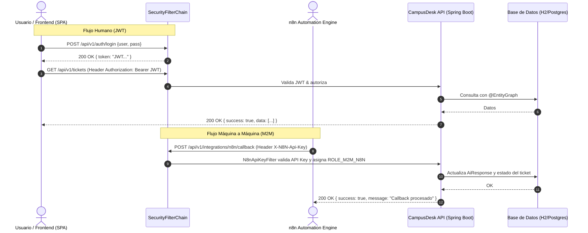

# CampusDesk API - Backend Contract & Technical Specification

## 1. Visión General del Sistema
**CampusDesk** es una plataforma integral de gestión de incidentes tecnológicos universitarios potenciada por Inteligencia Artificial y orquestación de flujos de trabajo automatizados con n8n. 

El backend ha sido construido bajo arquitectura limpia sobre **Spring Boot 3.3.5**, **Java 21**, **Spring Security 6 (Stateless JWT + Dual M2M)**, **Spring Data JPA** (con optimizaciones `@EntityGraph` para evitar problemas N+1), y **H2 Database** embebida en modo PostgreSQL para portabilidad 100% local sin dependencias externas (con soporte para PostgreSQL nativo mediante variables de entorno).

---

## 2. Configuración y Entorno de Ejecución Local

| Propiedad | Valor Predeterminado Local | Variable de Entorno Override |
| :--- | :--- | :--- |
| **Puerto del Servicio** | `8051` | `PORT` / `SERVER_PORT` |
| **URL Base API** | `http://localhost:8051/api/v1` | - |
| **Swagger UI** | `http://localhost:8051/swagger-ui.html` | - |
| **OpenAPI Docs (JSON)** | `http://localhost:8051/v3/api-docs` | - |
| **Base de Datos** | H2 File Engine (Modo PostgreSQL) | `DB_URL` |
| **JDBC URL** | `jdbc:h2:file:./data/campusdesk;DB_CLOSE_DELAY=-1;DB_CLOSE_ON_EXIT=FALSE;MODE=PostgreSQL` | `DB_URL` |
| **Driver BD** | `org.h2.Driver` (o `org.postgresql.Driver`) | `DB_DRIVER` |
| **Usuario BD** | `sa` | `DB_USERNAME` |
| **Password BD** | *(vacío)* | `DB_PASSWORD` |
| **Secreto JWT** | `campusdesk-dev-secret-key-32-bytes-minimum-length-2026!` | `JWT_SECRET` |
| **Expiración JWT** | `86400000` ms (24 horas) | `JWT_EXPIRATION` |
| **Header M2M n8n** | `X-N8N-Api-Key` | - |
| **Secreto M2M n8n** | `campusdesk-n8n-m2m-secret-key-2026` | `N8N_API_KEY` |
| **Webhook URL n8n** | `http://localhost:5678/webhook/campusdesk-ai` | `N8N_WEBHOOK_URL` |

> **Nota sobre el puerto 8051:** El frontend local (`Frontend/Scripts/config/api.config.js`) se encuentra preconfigurado para apuntar a `http://localhost:8051`, por lo que el backend se levanta directamente en dicho puerto asegurando comunicación inmediata sin necesidad de modificar el frontend.

---

## 3. Credenciales de Prueba Pre-sembradas (DataSeeder)

El sistema incluye un cargador automático de datos (`DataSeeder`) que inicializa roles RBAC, usuarios de prueba, perfiles de técnicos, artículos de conocimiento verificados y tickets de demostración:

| Usuario | Contraseña | Roles | Descripción / Categoría |
| :--- | :--- | :--- | :--- |
| `superadmin` | `SuperAdmin123!` | `ROLE_SUPERADMIN`, `ROLE_ADMIN` | Administrador supremo con acceso a auditoría y configuración |
| `tecnico_redes` | `Tecnico123!` | `ROLE_TECHNICIAN` | Técnico especializado en `REDES_CONECTIVIDAD` |
| `tecnico_hardware` | `Tecnico123!` | `ROLE_TECHNICIAN` | Técnico especializado en `HARDWARE_EQUIPOS` |
| `tecnico_software` | `Tecnico123!` | `ROLE_TECHNICIAN` | Técnico especializado en `SOFTWARE_SISTEMAS` |
| `usuario_campus` | `Usuario123!` | `ROLE_USER` | Usuario final / Docente / Estudiante reportante |
| **Integración n8n (M2M)** | *(API Key)* | `ROLE_M2M_N8N` | Enviar en cabecera HTTP: `X-N8N-Api-Key: campusdesk-n8n-m2m-secret-key-2026` |

---

## 4. Esquema de Respuestas y Manejo de Excepciones

### 4.1 Envoltorio de Éxito Estándar (`ApiResponse<T>`)
```json
{
  "success": true,
  "message": "Operación completada exitosamente",
  "data": { ... },
  "timestamp": "2026-11-12T10:00:00.000Z"
}
```

### 4.2 Envoltorio de Paginación (`PageResponse<T>`)
```json
{
  "content": [ ... ],
  "pageNumber": 0,
  "pageSize": 10,
  "totalElements": 25,
  "totalPages": 3,
  "first": true,
  "last": false,
  "empty": false
}
```

### 4.3 Envoltorio de Error Estándar (`ErrorResponse`)
```json
{
  "success": false,
  "status": 400,
  "error": "Bad Request",
  "message": "Validation failed for one or more fields",
  "path": "/api/v1/tickets",
  "timestamp": "2026-11-12T10:00:00.000Z",
  "validationErrors": {
    "title": "El título es obligatorio",
    "category": "La categoría no puede ser nula"
  }
}
```

---

## 5. Catálogo Completo de Endpoints RESTful

### 5.1 Módulo de Autenticación (`/api/v1/auth`)

#### `POST /api/v1/auth/login`
- **Seguridad:** Público (`PermitAll`)
- **Request Body:**
```json
{
  "username": "superadmin",
  "password": "SuperAdmin123!"
}
```
- **Response (200 OK):**
```json
{
  "success": true,
  "message": "Autenticación exitosa",
  "data": {
    "token": "eyJhbGciOiJIUzI1NiIsInR5cCI6IkpXVCJ9...",
    "refreshToken": "eyJhbGciOiJIUzI1NiIsInR5cCI6IkpXVCJ9...",
    "type": "Bearer",
    "username": "superadmin",
    "email": "superadmin@campusdesk.edu",
    "roles": ["ROLE_SUPERADMIN", "ROLE_ADMIN"]
  },
  "timestamp": "2026-11-12T10:00:00.000Z"
}
```

#### `POST /api/v1/auth/register`
- **Seguridad:** Público (`PermitAll`)
- **Request Body:**
```json
{
  "username": "juan_perez",
  "password": "Password123!",
  "email": "juan.perez@campusdesk.edu",
  "firstName": "Juan",
  "lastName": "Pérez",
  "department": "Ingeniería de Sistemas",
  "phone": "+57 3001234567"
}
```
- **Response (201 Created):**
```json
{
  "success": true,
  "message": "Usuario registrado exitosamente",
  "data": {
    "id": 6,
    "username": "juan_perez",
    "email": "juan.perez@campusdesk.edu",
    "firstName": "Juan",
    "lastName": "Pérez",
    "department": "Ingeniería de Sistemas",
    "roles": ["ROLE_USER"]
  },
  "timestamp": "2026-11-12T10:00:00.000Z"
}
```

#### `POST /api/v1/auth/refresh`
- **Seguridad:** Público (`PermitAll`)
- **Request Body:** `{"refreshToken": "eyJhbGciOi..."}`
- **Response (200 OK):** `{"token": "nuevo_jwt...", "type": "Bearer"}`

#### `GET /api/v1/auth/me`
- **Seguridad:** Requiere autenticación (`Bearer <jwt>`)
- **Response (200 OK):** Información del usuario autenticado con roles y permisos.

#### `PUT /api/v1/auth/change-password`
- **Seguridad:** Requiere autenticación (`Bearer <jwt>`)
- **Request Body:** `{"currentPassword": "OldPass123!", "newPassword": "NewPass456!"}`

---

### 5.2 Módulo de Catálogos y Usuarios (`/api/v1/catalog`, `/api/v1/users`)

#### `GET /api/v1/catalog/roles`
- **Seguridad:** `ROLE_ADMIN`, `ROLE_SUPERADMIN`
- **Response (200 OK):** Lista de roles con sus permisos asociados.

#### `GET /api/v1/users`
- **Seguridad:** `ROLE_ADMIN`, `ROLE_SUPERADMIN`
- **Parámetros URL:** `page=0`, `size=10`, `search=tecnico`, `status=ACTIVE`
- **Response (200 OK):** `PageResponse<UserDto>`

#### `PUT /api/v1/users/{id}/status`
- **Seguridad:** `ROLE_ADMIN`, `ROLE_SUPERADMIN`
- **Parámetros URL:** `status=ACTIVE|INACTIVE|SUSPENDED`

#### `POST /api/v1/users/{id}/roles/{roleName}`
- **Seguridad:** `ROLE_SUPERADMIN`
- **Asigna un nuevo rol al usuario.**

---

### 5.3 Módulo de Técnicos (`/api/v1/technicians`)

#### `GET /api/v1/technicians`
- **Seguridad:** `ROLE_ADMIN`, `ROLE_SUPERADMIN`, `ROLE_COORDINATOR`
- **Response (200 OK):** Lista de perfiles de técnicos con nivel, especialidad, disponibilidad y carga de trabajo actual (`currentAssignedTickets`).

#### `PUT /api/v1/technicians/{id}/availability`
- **Seguridad:** `ROLE_ADMIN`, `ROLE_SUPERADMIN`, o el propio `ROLE_TECHNICIAN`
- **Parámetros URL:** `available=true|false`

#### `GET /api/v1/technicians/specialty/{category}`
- **Seguridad:** `ROLE_ADMIN`, `ROLE_SUPERADMIN`, `ROLE_COORDINATOR`
- **Categorías soportadas:** `REDES_CONECTIVIDAD`, `HARDWARE_EQUIPOS`, `SOFTWARE_SISTEMAS`, `SERVICIOS_TI`, `SEGURIDAD_ACCESOS`, `GENERAL`

---

### 5.4 Módulo de Gestión de Tickets (`/api/v1/tickets`)

#### `POST /api/v1/tickets`
- **Seguridad:** Cualquier usuario autenticado
- **Request Body:**
```json
{
  "title": "Falla en conexión WiFi de la Biblioteca Central",
  "description": "Los estudiantes del tercer piso no se pueden autenticar en la red Campus_Wifi.",
  "category": "REDES_CONECTIVIDAD",
  "priority": "HIGH",
  "location": "Biblioteca Central - Piso 3",
  "impact": "HIGH",
  "urgency": "HIGH"
}
```
- **Response (201 Created):**
```json
{
  "success": true,
  "message": "Ticket creado exitosamente",
  "data": {
    "id": 1,
    "ticketNumber": "TICK-202611-0001",
    "title": "Falla en conexión WiFi de la Biblioteca Central",
    "description": "Los estudiantes del tercer piso...",
    "category": "REDES_CONECTIVIDAD",
    "status": "OPEN",
    "priority": "HIGH",
    "impact": "HIGH",
    "urgency": "HIGH",
    "location": "Biblioteca Central - Piso 3",
    "creator": {
      "id": 5,
      "username": "usuario_campus",
      "firstName": "Usuario",
      "lastName": "Campus"
    },
    "createdAt": "2026-11-12T10:05:00.000Z"
  }
}
```

#### `GET /api/v1/tickets`
- **Seguridad:** Usuario autenticado (Usuarios regulares ven únicamente sus tickets creados; Administradores y Técnicos ven todos los pertinentes).
- **Filtros Dinámicos (Specification JPA):**
  - `status=OPEN,IN_PROGRESS,PENDING`
  - `category=REDES_CONECTIVIDAD`
  - `priority=HIGH`
  - `search=WiFi`
  - `assignedTechnicianId=2`
  - `unassignedOnly=true`
  - `dateFrom=2026-11-01`
  - `dateTo=2026-11-30`
  - `page=0&size=10&sortBy=createdAt&sortDir=desc`
- **Response (200 OK):** `PageResponse<TicketDto>`

#### `GET /api/v1/tickets/{id}`
- **Seguridad:** Creador del ticket, Técnico asignado, Coordinador o Admin.
- **Response (200 OK):** Detalle completo del ticket incluyendo historial de estados, técnico asignado, consultas de IA asociadas y comentarios.

#### `PATCH /api/v1/tickets/{id}/status`
- **Seguridad:** Usuario autenticado con rol pertinente.
- **Request Body:**
```json
{
  "newStatus": "RESOLVED",
  "comment": "Se reinició el punto de acceso AP-P3-02 y se reconfiguró el canal de radio."
}
```

#### `POST /api/v1/tickets/{id}/assign`
- **Seguridad:** `ROLE_ADMIN`, `ROLE_SUPERADMIN`, `ROLE_COORDINATOR`
- **Request Body:**
```json
{
  "technicianUserId": 2,
  "reason": "Especialista disponible en el área de redes"
}
```

#### `POST /api/v1/tickets/{id}/auto-assign`
- **Seguridad:** `ROLE_ADMIN`, `ROLE_SUPERADMIN`, `ROLE_COORDINATOR`
- **Descripción:** Algoritmo heurístico que busca técnicos disponibles cuya especialidad coincida con la categoría del ticket y selecciona al que tenga menor carga actual (`currentAssignedTickets`).

---

### 5.5 Módulo de Comentarios e Historial (`/api/v1/tickets/{id}/comments`)

#### `POST /api/v1/tickets/{id}/comments`
- **Seguridad:** Usuario creador, Técnico asignado o Admin
- **Request Body:**
```json
{
  "content": "Hemos enviado una cuadrilla técnica para revisar el cableado físico.",
  "internal": false
}
```
*(Nota: Comentarios con `"internal": true` solo son visibles para técnicos y administradores).*

---

### 5.6 Módulo de Base de Conocimiento RAG (`/api/v1/knowledge`)

#### `GET /api/v1/knowledge`
- **Seguridad:** Cualquier usuario autenticado
- **Filtros:** `category`, `search`, `isVerified=true`, `page=0`, `size=10`

#### `POST /api/v1/knowledge`
- **Seguridad:** `ROLE_ADMIN`, `ROLE_SUPERADMIN`, `ROLE_COORDINATOR`
- **Request Body:**
```json
{
  "title": "Procedimiento de reinicio de Access Points Cisco en Campus",
  "category": "REDES_CONECTIVIDAD",
  "problemSummary": "Pérdida de señal o saturación en bandas 5GHz",
  "solutionSteps": "1. Conectar por SSH al controlador. 2. Ejecutar ap reset. 3. Verificar canal.",
  "keywords": "wifi, cisco, access point, red, conectividad"
}
```

#### `POST /api/v1/knowledge/{id}/verify`
- **Seguridad:** `ROLE_ADMIN`, `ROLE_SUPERADMIN`
- **Marca el artículo como verificado para su priorización en respuestas de IA RAG.**

---

### 5.7 Módulo de Dashboard y Métricas (`/api/v1/dashboard`)

#### `GET /api/v1/dashboard/metrics`
- **Seguridad:** `ROLE_ADMIN`, `ROLE_SUPERADMIN`, `ROLE_COORDINATOR`
- **Response (200 OK):**
```json
{
  "success": true,
  "data": {
    "totalTickets": 6,
    "openTickets": 2,
    "inProgressTickets": 1,
    "pendingTickets": 1,
    "resolvedTickets": 1,
    "closedTickets": 1,
    "unassignedTickets": 2,
    "slaCompliancePercentage": 100.0,
    "ticketsByCategory": {
      "REDES_CONECTIVIDAD": 2,
      "HARDWARE_EQUIPOS": 2,
      "SOFTWARE_SISTEMAS": 2
    },
    "ticketsByPriority": {
      "HIGH": 2,
      "MEDIUM": 2,
      "LOW": 2
    },
    "totalKnowledgeArticles": 5,
    "activeTechnicians": 3
  }
}
```

---

### 5.8 Módulo de Integración M2M con n8n y Motor de IA (`/api/v1/integrations/n8n`)

#### `POST /api/v1/integrations/n8n/trigger`
- **Seguridad:** Cualquier usuario autenticado o cliente M2M
- **Descripción:** Dispara una consulta al motor de IA / flujo de n8n. Si n8n está fuera de línea (`ConnectException` / `Timeout`), el backend activa de inmediato su **Motor RAG Local de Respaldo**, buscando en los artículos de base de conocimiento verificados y calculando fuentes y similitud semántica sin interrumpir la experiencia.
- **Request Body:**
```json
{
  "ticketId": 1,
  "naturalQuery": "¿Cómo solucionar la falta de conexión en los Access Points de la biblioteca?",
  "category": "REDES_CONECTIVIDAD",
  "contextMetadata": {
    "source": "frontend_web",
    "browser": "Chrome"
  }
}
```
- **Response (200 OK):**
```json
{
  "success": true,
  "message": "Consulta procesada exitosamente",
  "data": {
    "queryId": 1,
    "ticketId": 1,
    "status": "COMPLETED",
    "generatedAnswer": "Basado en la base de conocimientos de CampusDesk: Para resolver incidentes de conectividad WiFi: 1. Reiniciar el Access Point correspondiente. 2. Verificar que el switch PoE entregue energía adecuada. 3. Confirmar asignación de IP por DHCP.",
    "confidenceScore": 0.92,
    "sources": [
      {
        "articleId": 1,
        "title": "Solución de problemas en redes Wi-Fi Eduroam y Campus",
        "category": "REDES_CONECTIVIDAD",
        "similarityScore": 0.95
      }
    ],
    "suggestedCategory": "REDES_CONECTIVIDAD",
    "suggestedPriority": "HIGH",
    "requiresHumanEscalation": false,
    "processingTimeMs": 45
  }
}
```

#### `POST /api/v1/integrations/n8n/callback`
- **Seguridad:** M2M (`X-N8N-Api-Key: campusdesk-n8n-m2m-secret-key-2026`) o Administrador
- **Descripción:** Webhook donde n8n envía los resultados generados por su flujo (LangChain, OpenAI, DeepSeek, etc.). Idempotente.
- **Request Body:**
```json
{
  "queryId": 1,
  "generatedAnswer": "Respuesta generada por el agente de n8n...",
  "confidenceScore": 0.96,
  "suggestedCategory": "REDES_CONECTIVIDAD",
  "suggestedPriority": "HIGH",
  "requiresHumanEscalation": false,
  "sources": [
    {
      "articleId": 1,
      "title": "Solución de problemas en redes Wi-Fi",
      "category": "REDES_CONECTIVIDAD",
      "similarityScore": 0.97
    }
  ]
}
```

#### `GET /api/v1/integrations/n8n/data`
- **Seguridad:** M2M (`X-N8N-Api-Key: campusdesk-n8n-m2m-secret-key-2026`) o Administrador
- **Descripción:** Permite a los workflows de n8n consultar el contexto estructurado de tickets y base de conocimientos para alimentarlo a vectores o memoria semántica.
- **Parámetros:** `type=all|tickets|knowledge`, `limit=50`

#### `POST /api/v1/integrations/n8n/queries/{id}/rate`
- **Seguridad:** Cualquier usuario autenticado
- **Descripción:** Califica la respuesta entregada por la IA para métricas de efectividad RAG.
- **Request Body:**
```json
{
  "rating": 5,
  "feedback": "Excelente respuesta, solucionó el problema en minutos.",
  "wasHelpful": true
}
```

#### `GET /api/v1/integrations/n8n/queries/ticket/{ticketId}`
- **Seguridad:** Cualquier usuario autenticado
- **Response (200 OK):** Historial cronológico de consultas y respuestas de IA generadas para ese ticket.

---

## 6. Diagrama de Flujo de Autenticación Dual (Frontend vs n8n)



---

## 7. Instrucciones para Ejecución y Pruebas en Entorno Local

1. **Requisitos Previos:**
   - Java 21 JDK instalado (`java -version`).
   - Maven 3.8+ (`mvn -version`).
2. **Compilación y Empaquetado:**
   ```powershell
   mvn clean package -DskipTests
   ```
3. **Ejecución del Servidor:**
   ```powershell
   mvn spring-boot:run
   ```
   *(o ejecutando el jar generado en `target/campusdesk-backend-0.0.1-SNAPSHOT.jar`)*
4. **Verificación en el Navegador:**
   - Swagger UI: `http://localhost:8051/swagger-ui.html`
   - Consola H2: `http://localhost:8051/h2-console` (JDBC URL: `jdbc:h2:file:./data/campusdesk`, User: `sa`, Password: *(vacío)*)
5. **Ejecución de Pruebas de Humo:**
   ```powershell
   mvn test -Dtest=CampusDeskSmokeIntegrationTest
   ```
